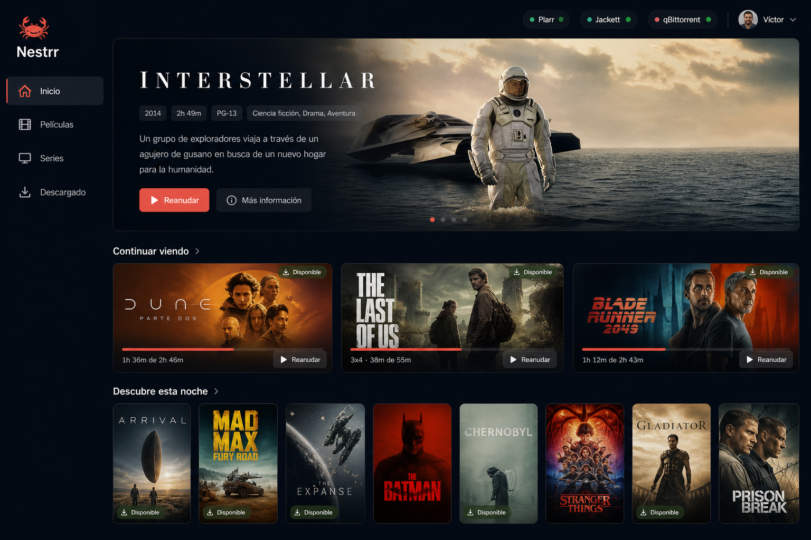
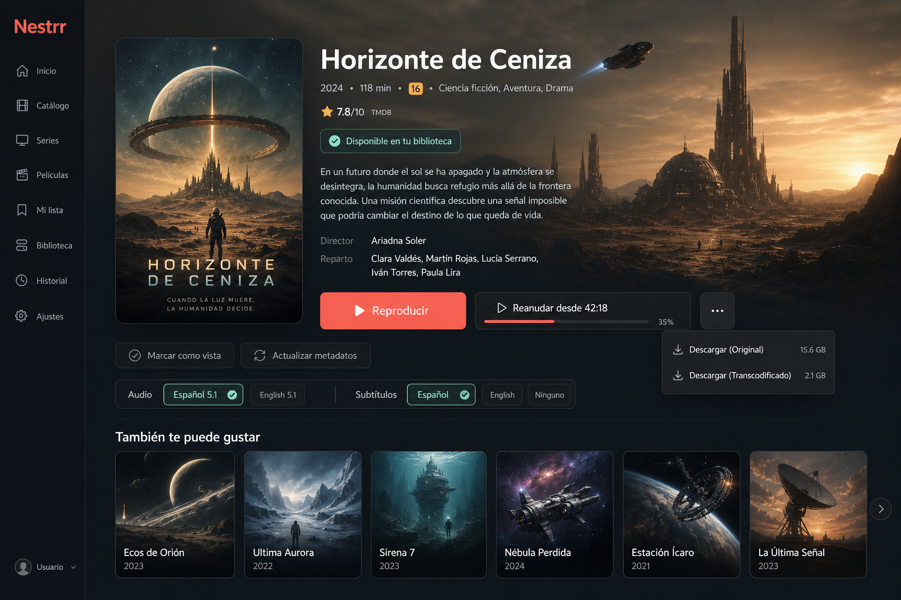
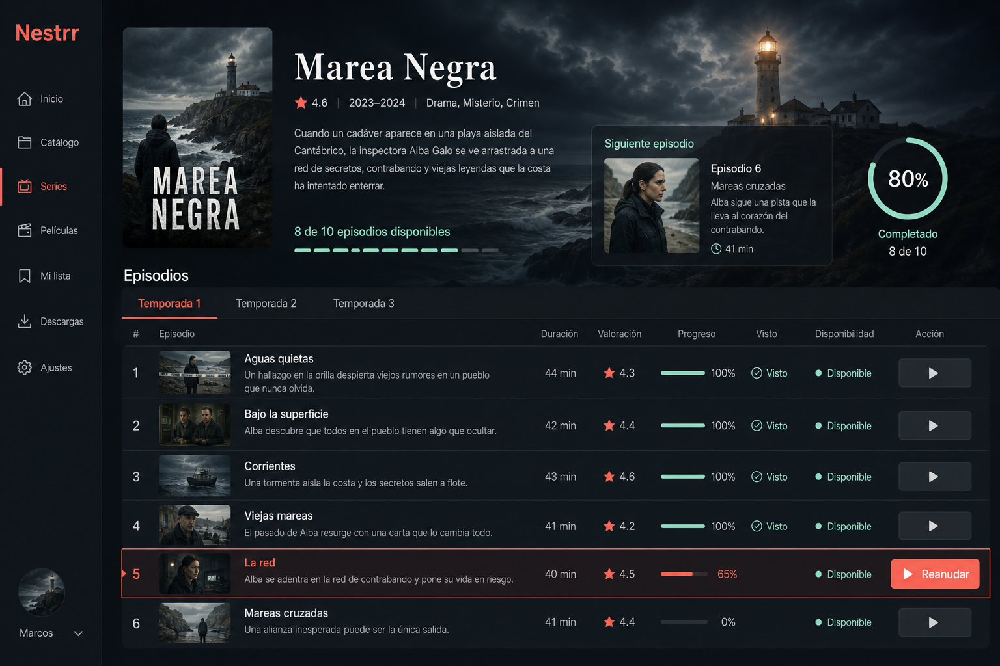
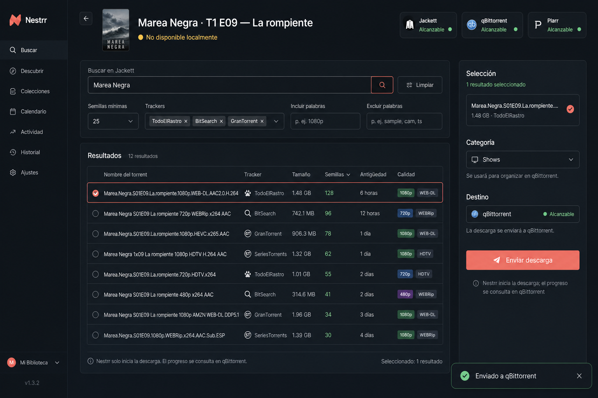
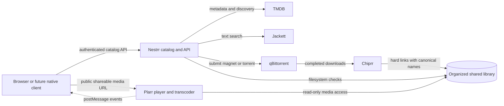

# Nestrr

Nestrr is a self-hosted movie and TV catalog designed as a focused alternative to the library and discovery parts of Jellyfin. It combines a TMDB-backed catalog, filesystem-aware availability, per-user playback progress, and optional Jackett/qBittorrent integration.

Playback and transcoding are deliberately delegated to [Plarr](https://github.com/victor141516/Plarr), a separate standalone web player. Downloaded files are normalized by [Chiprr](https://github.com/victor141516/chiprr), which remains independent from both Nestrr and Plarr.

## Quick start

Copy `.env.example` to `.env`, configure the required secrets and TMDB token, then start the stack.

CPU-only host:

```powershell
docker compose up -d --build
```

NVIDIA host, including Docker Desktop with WSL:

```powershell
docker compose -f docker-compose.yml -f docker-compose.nvidia.yml up -d --build
```

Always include `docker-compose.nvidia.yml` when recreating the stack on an NVIDIA host. Starting only the base file removes Plarr's GPU request and forces transcoding onto the CPU. See [DEPLOYMENT.md](DEPLOYMENT.md) for storage, reverse proxy, qBittorrent, Jackett, FlareSolverr, security, and recovery details.

## Visual direction

The following mockups define the intended visual direction for the initial web application. They are implementation guides rather than exact pixel-level specifications: real metadata, artwork, responsive behavior, accessibility, and supported features remain authoritative over the illustrative content shown here.

The interface should preserve these characteristics across catalog views:

- a restrained, cinematic dark theme with clear content hierarchy;
- coral primary actions, mint local-availability indicators, and subdued amber unavailable states;
- an explicit distinction between shared filesystem availability and per-user playback progress or watched state;
- compact navigation and integration health information that do not compete with catalog content;
- readable, information-rich layouts that remain approachable rather than resembling a server administration dashboard.

### Explore

The Explore view combines continuing playback, search, filters, and discovery in one place.



### Movie details

Movie details combine metadata, local availability, resume state, playback preferences, media-download actions, and related titles without obscuring the primary play action.



### Show and season details

Show views keep aggregate availability separate from completion progress and make episode-level availability, watched state, and resume position scannable.



### Optional download initiation

When Jackett and qBittorrent are configured, torrent search remains a focused, user-directed flow. Nestrr submits the selected result but does not become a download manager or duplicate qBittorrent's progress UI.



## Goals

- Provide a rich catalog for discovering movies, collections, shows, seasons, and episodes.
- Make locally available content immediately recognizable and playable.
- Preserve independent watch progress and playback preferences for multiple users while sharing one media library.
- Delegate adaptive web playback and transcoding to a reusable standalone service.
- Allow optional, user-directed torrent searches and downloads without becoming a download manager.
- Keep every component independently deployable and configured through environment variables.
- Expose versioned APIs so future Android, iOS, and TV clients can use the same backend capabilities as the web SPA.
- Prefer small, understandable components over a monolithic media server.

## Non-goals

- Reimplementing TMDB or mirroring its entire global dataset in advance.
- Managing qBittorrent's queue, lifecycle, or initial download progress in the first version.
- Communicating directly with Chiprr or asking Chiprr to rescan on demand.
- Supporting sidecar subtitles or auxiliary media files initially.
- Supporting multiple video files for one movie or episode initially.
- Supporting multi-episode files, anime absolute numbering, specials, or season zero initially.
- Providing personalized recommendation algorithms in the first version.
- Providing Chromecast or AirPlay in the first version; the architecture must leave room for them.
- Restricting access to Plarr media with Nestrr authentication.

## System overview



The system consists of three first-party services:

1. **Nestrr** owns catalog discovery, metadata, users, availability, playback progress, and download initiation.
2. **Plarr** owns browser playback, direct play, adaptive streaming, transcoding, track selection, and media downloads.
3. **Chiprr** watches completed downloads and creates canonical hard links in the organized library.

The services do not share a database and do not call Chiprr. The organized filesystem and explicit public APIs are their contracts.

## Technology constraints

### Backends

- New backend services must be written in Go or Rust.
- The final language may be selected per service, although using one language for Plarr and Nestrr is preferred if it does not compromise the implementation.
- Each service must build into a simple, self-contained Docker image.
- Configuration is supplied through environment variables. Runtime configuration must not require a collection of manually maintained files.
- Plarr's image includes its backend, embedded frontend assets, FFmpeg, and the FFmpeg libraries/codecs required by the supported transcoding paths.
- Depending on FFmpeg inside the image is expected. Embedding an unrelated external transcoder project as a separately managed service or binary is not.
- Chiprr remains TypeScript and is outside the language migration scope.

### Frontends

- TypeScript.
- Vue.
- Vite.
- Vitest.
- Tailwind CSS.
- Single-page applications consuming versioned HTTP APIs.
- English and Spanish UI translations initially. An unsupported UI language falls back to English.

## Deployment model

The intended deployment uses Docker and a private container network, but both the Nestrr web origin and Plarr web origin may be exposed to the internet.

The host must provide:

- a shared organized media filesystem mounted read-only into Nestrr and Plarr;
- separate qBittorrent incomplete and completed directories;
- completed directories and organized library directories on the same filesystem so Chiprr can create hard links;
- optional Jackett and qBittorrent services;
- optional GPU devices/drivers exposed to the Plarr container.

No application-level limit is imposed on simultaneous playback or transcode sessions. Actual concurrency is limited by host CPU, GPU, memory, disk, and network capacity.

## Canonical library layout

Chiprr is the source of truth for title normalization, invalid-character handling, and output paths. Nestrr must implement exactly the same normalization contract when deriving an expected path.

No TMDB identifier is stored in filenames.

### Movies

The organized movie directory is flat:

```text
Movies/
├── Jurassic Park (1993).mkv
├── Arrival (2016).mp4
└── Some Movie.avi
```

The canonical title is the English TMDB title. The year is included when TMDB supplies one. Until Chiprr movie support lands, the definitive contract is tracked in [Chiprr issue #16](https://github.com/victor141516/chiprr/issues/16).

### TV shows

```text
Shows/
└── Breaking Bad/
    └── Season 1/
        └── Breaking Bad S01E01.mkv
```

The required form is:

```text
<English show name>/Season <number>/<English show name> S<two-digit season>E<two-digit episode>.<extension>
```

### Initial media limitations

- One video file represents exactly one movie or one episode.
- Sidecar subtitles and auxiliary files are ignored.
- Multi-episode files are not resolved.
- Anime absolute numbering is not resolved.
- Specials and season zero are not resolved.
- Every supported show episode has a positive season number and a positive episode number.
- Movies with the same canonical English title and release year share one filesystem stem because filenames do not contain a TMDB ID. A single file can therefore appear available on more than one TMDB movie page; this is a known limitation.
- If more than one supported extension exists for the same canonical stem, Nestrr selects the same one deterministically by sorting candidate paths alphabetically and taking the first. This is considered a library-owner problem rather than a catalog error.

## Nestrr catalog

### Catalog content

Nestrr exposes TMDB-backed views for:

- movie search and discovery;
- TV-show search and discovery;
- genre and other TMDB-supported filters;
- movie detail pages;
- movie collections/sagas, including collection artwork and description when TMDB provides them;
- show detail pages;
- seasons with their artwork and metadata;
- episodes with title, description, artwork, rating, and other available metadata;
- TMDB's related/recommended titles for a selected item.

Nestrr is not restricted to downloaded content. It is a general catalog similar in spirit to JustWatch, with local availability layered on top.

### TMDB request cache

Raw TMDB requests use a short-lived HTTP cache:

- The cache key is the complete normalized upstream request, including URL, query string, language, and other response-affecting parameters.
- The value is the unmodified upstream response plus cache metadata.
- The default TTL should be less than one day; one hour is the initial recommended default and must be configurable.
- A valid cache entry prevents a duplicate TMDB request.
- Once expired, the response is fetched again and replaced.
- Cached/local results may be displayed immediately while an expired entry is refreshed.

### Owned metadata store

Once Nestrr obtains the detail document for a movie, collection, show, season, or episode, that document becomes long-lived application data:

- Store the TMDB JSON payload without reshaping it into a second proprietary metadata schema.
- Local indexing columns may be stored beside the payload for queries and relationships.
- Metadata has no automatic TTL.
- Metadata is logically scoped by user, content identifier, content type, and requested metadata language.
- Implementations may deduplicate identical immutable blobs internally, but one user's refresh or deletion must not invalidate another user's logical metadata entry.
- Images are downloaded and cached physically on the server. Database records refer to the local cached asset and its upstream source.
- The user can manually refresh the current item.
- The user can clear all of their own stored metadata from settings.
- Changing language does not automatically delete or refetch existing metadata. Mixed-language results after a language change are acceptable until the user explores/refreshes content or clears their metadata.

Refresh semantics are hierarchical but intentionally conservative:

- Refreshing a movie or episode replaces that exact item's metadata.
- Refreshing a show replaces the show's own metadata and discovers/fetches newly listed seasons and episodes.
- Existing season and episode metadata is retained when refreshing the parent show.
- Refreshing a season may discover new episodes but does not replace already stored episode metadata.
- To replace an existing episode's metadata, refresh that episode explicitly.

### Per-user language

- Every user selects their own language.
- The administrator cannot set a language for all users.
- The selected language is sent to TMDB for that user's metadata requests.
- Filesystem paths never use localized metadata. Movies, shows, and episodes
  are always resolved with their canonical English TMDB title.
- Before a user has selected an audio track for an item, the primary language
  subtag from this setting is sent to Plarr as the preferred audio language.
- English and Spanish have translated Nestrr interfaces initially.
- If a user selects Portuguese or another unsupported UI language, the interface falls back to English while TMDB metadata is requested in the selected language.

### Recommendations

The first version uses TMDB's relationships and recommendations for a selected title.

The catalog must expose a broad recommendation-provider boundary for a future personalized engine. A provider should eventually be able to receive combinations of:

- user watch history;
- watched/unwatched state;
- one or more seed titles;
- genres;
- media type;
- ratings and recency;
- explicit modes such as “similar to this”, “because you watched”, or “within this genre”.

No personalized ranking algorithm is required initially.

## Filesystem availability

The organized library is shared by every user. Watch progress, watched state, metadata language, and playback preferences are per user; the underlying files are not.

Browser sessions use a two-hour access token. While Nestrr remains visible, the
web client renews it shortly before expiration using the rotating HttpOnly
refresh cookie. A rejected request still triggers one reactive refresh and
retry as a fallback. Hidden tabs wait until they become visible again.

The filesystem is authoritative. Database availability is only an acceleration structure.

### Visible catalog results

When a search, discovery filter, or recommendation list is displayed:

1. Return metadata results immediately from the owned store or TMDB request cache.
2. Lazily derive and check each result's canonical filesystem path.
3. Stream availability updates to the client as checks finish.
4. Display a downloaded badge when the file exists.
5. Update the advisory availability index with the observation.

This makes a newly organized file appear without a global rescan when its item is visible.

### Downloaded-only views and filters

Nestrr supports both:

- a dedicated page built from the organized filesystem and resolved back to TMDB items;
- a “downloaded only” filter inside normal search/discovery views.

The advisory availability index can participate in database queries for these views, but results must be revalidated lazily against the filesystem. If an expected file disappeared, mark it unavailable and update the UI/index. Opening the dedicated downloaded page triggers a lightweight library enumeration so newly added canonical files appear without requiring a manual full-library rescan action.

### Aggregate availability

- A movie is either available or unavailable.
- A season or show displays a complete indicator if all supported children are available.
- It displays a partial indicator if at least one but not all supported children are available.
- It displays no downloaded indicator if none are available.

## Plarr integration

Plarr is a standalone project and must remain useful without Nestrr. Nestrr knows Plarr only through a configured host URL and public contracts.

If `PLARR_HOST` is absent or unhealthy:

- Nestrr continues operating as a catalog;
- all playback controls are hidden;
- original/transcoded media download controls are hidden;
- metadata discovery, local availability, users, and optional torrent initiation continue working.

### Public player model

Plarr is intentionally public and does not use Nestrr authentication, signed URLs, or expiring playback tokens.

- A Plarr link containing a media path can be copied and shared with anyone who can reach Plarr.
- The recipient can play the file independently; shared links do not synchronize playback sessions.
- Public access applies to playback, the original-file download, and explicitly requested transcoded downloads.
- Public access never permits uploads, filesystem mutation, or selection of a file outside the configured media root.

### Path URL contract

- The relative local media path is encoded in the browser URL fragment, not sent as an unescaped query parameter.
- A provisional human-facing form is:

  ```text
  https://plarr.example/#/play/<base64url-encoded-relative-path>?start=120&audio=es&subtitles=en&subtitlesEnabled=true
  ```

- Because the fragment is client-side, the SPA converts it into a deterministic public media identifier/API URL.
- The resulting HLS master-playlist URL is derived from the normalized relative path alone and does not require a signature.
- Plarr validates the path only when media is requested. Deterministic URL construction does not require the file to exist first.
- `PLARR_MEDIA_ROOT` defines the only filesystem tree Plarr can read.
- Every request must decode, normalize, resolve, and realpath-check the requested file and ensure it remains under the real configured root. Reject traversal, absolute-path injection, and symlink escapes.
- Only supported video files may be played/downloaded.
- A future file browser when no path is supplied is allowed, but is not part of the initial implementation.

### Iframe lifecycle

Nestrr opens Plarr in a full-screen iframe. Plarr owns the controls and video element; Nestrr owns catalog navigation.

- `next` and `previous` actions are sent from Plarr to the parent SPA through a versioned `postMessage` event.
- Nestrr resolves which catalog item is next or previous.
- Nestrr closes/replaces the current iframe and opens the selected file in a new Plarr iframe.
- The next episode crosses season boundaries automatically.
- If the next episode is unavailable, Nestrr navigates to its detail page instead of invoking Plarr. The page offers torrent search when that integration is available.
- Autoplay proceeds to the next item after a five-second countdown. The user can cancel it.
- Direct standalone Plarr usage has no catalog-provided next/previous resolution.

Both sides must validate message shape, protocol version, source window, and expected origin. Event payloads must never be interpreted as authorization to access an arbitrary path.

## Plarr playback requirements

Although Plarr is implemented in its own repository, these requirements define Nestrr's dependency.

### Direct play and transcoding

- Start with the original resolution and direct-play/remux whenever the browser supports the source container, video codec, audio codec, and tracks.
- If the client cannot decode the source, transcode to H.264 at the closest ladder resolution to the source.
- H.264 is the universal fallback because target devices commonly provide hardware decoding.
- FFmpeg performs probing, remuxing, segmenting, and transcoding.
- The player must switch rendition without reloading the page, losing the timeline, or changing the occupied layout size.
- Codec, resolution, and bitrate changes are expected at segment boundaries.

Initial video ladder (provisional defaults, configurable before implementation is finalized):

| Label | Maximum height | Target video bitrate |
| ----- | -------------: | -------------------: |
| 2160p |           2160 |              16 Mbps |
| 1080p |           1080 |               8 Mbps |
| 720p  |            720 |               5 Mbps |
| 480p  |            480 |             2.5 Mbps |
| 360p  |            360 |               1 Mbps |
| 240p  |            240 |             500 Kbps |

Never upscale above the source. Preserve aspect ratio. Audio bitrate/profile must be selected separately and remain broadly browser-compatible.

### Conservative adaptive bitrate policy

Avoiding stalls has higher priority than maximizing image quality.

- Drop one or more renditions quickly when measured throughput/buffer health indicates imminent starvation.
- Upgrade only one rung at a time.
- Require at least 20 continuous seconds of comfortably sufficient throughput and healthy buffer before an upgrade.
- Use a safety margin rather than comparing bitrate directly to measured bandwidth.
- If an upgrade causes a stall or immediate downgrade, return quickly to the previous stable rendition.
- After two failed attempts to use the same higher rendition in one session, keep the last stable lower rendition unless conditions become substantially different or the user selects a manual quality.
- Oscillating bandwidth should bias toward the lower stable rendition.
- A manual quality selection disables automatic changes and remains fixed until the user chooses another rendition or returns to Auto.
- Playback resolution is not persisted by Nestrr between sessions; every new playback begins in Auto.

### Browser support

Required initially:

- Chrome;
- Edge;
- Safari on macOS;
- Safari/web playback on iPhone.

Firefox is best-effort initially if supporting it does not require a separate playback architecture.

### Hardware acceleration

Plarr should detect and use available FFmpeg hardware paths for:

- Intel;
- AMD;
- NVIDIA.

CPU transcoding is the required fallback. Apple hardware acceleration is not an initial Docker requirement because macOS does not provide the target native container/GPU deployment model. The image must not assume that a GPU exists; host device/driver exposure remains an operator responsibility.

### Audio and subtitles

- Enumerate embedded audio and subtitle tracks.
- Allow manual track changes without a page reload.
- Start with the simplest broadly supported embedded subtitle formats and expand format coverage later.
- Sidecar subtitle files are initially unsupported.
- The player URL accepts preferred audio language, preferred subtitle language, subtitle enabled/disabled state, and start position from the beginning.
- A title discriminator may also be supplied when Nestrr has one.

Track matching is deterministic:

1. Match the saved/requested language.
2. If exactly one track has that language, choose it regardless of title.
3. If multiple tracks share the language, prefer an exact normalized title match.
4. If no title matches, sort the same-language tracks deterministically by normalized title and stable stream index and choose the first.
5. If no track has the requested language, use Plarr's deterministic default.

This supports cases such as “Español de España” versus “Latinoamericano” while remaining robust when a replacement file contains different track titles.

### Segment cache

- Segment storage is a configurable directory suitable for a Docker volume.
- Clear the entire segment directory when Plarr starts.
- Do not delete a session's segments merely because playback closes.
- Keep reusable segments until the configured disk limit is reached.
- Default limit: 10 GB, configurable by environment variable.
- At the limit, remove the oldest unused/cold segments until sufficient space is available.
- Cache cleanup must tolerate crashes and orphaned sessions because startup cleanup is authoritative.

### Playback events

The browser player sends structured events to its parent via `postMessage`; Plarr does not deliver catalog webhooks.

Minimum event types:

- ready/opened;
- play;
- pause;
- seek;
- heartbeat;
- ended;
- closed/page-hidden when observable;
- audio-track-changed;
- subtitle-track-changed;
- subtitles-enabled/disabled;
- automatic rendition changed;
- manual quality changed;
- next requested;
- previous requested;
- playback error.

A provisional envelope is:

```json
{
  "source": "plarr",
  "version": 1,
  "eventId": "uuid",
  "sessionId": "uuid",
  "type": "heartbeat",
  "mediaPath": "Shows/Breaking Bad/Season 1/Breaking Bad S01E01.mkv",
  "positionSeconds": 123.4,
  "durationSeconds": 3540.2,
  "paused": false,
  "occurredAt": "2026-08-27T12:00:00.000Z"
}
```

- Positions are absolute, not deltas.
- Event IDs allow idempotent catalog ingestion.
- The heartbeat interval is five seconds while playback is progressing.
- A missing close event is normal; the last heartbeat bounds lost progress to approximately five seconds.
- Standalone Plarr ignores the absence of a parent and does not persist progress.

### Media downloads

For an available item Nestrr offers:

- download original file;
- a dropdown for downloading a transcoded rendition.

Both operations are served by Plarr and follow the same public path containment rules as playback. A transcoded download produces a normal downloadable media file rather than an interactive HLS session.

## Playback progress and watched state

Progress belongs to `(user, catalog item)`, not merely to a filesystem path, so replacing a file does not lose the user's state.

Store at least:

- absolute playback position;
- duration observed;
- updated timestamp;
- watched flag and watched timestamp;
- last Plarr event ID/session ID used for idempotency;
- preferred audio language and optional track title;
- preferred subtitle language and optional track title;
- subtitle enabled state.
- whether the initial playback threshold has been reached and when.

Rules:

- Resume five seconds before the last stored position, clamped to zero.
- Do not create visible progress until 30 seconds of actual playback have accumulated since the latest seek. Paused time and a suspended tab do not count; seeking resets this initial gate.
- Once visible progress exists, save subsequent position changes immediately without requiring another 30-second gate.
- Complete an item at 95% of its duration. Completion adds a movie, or a series whose released episodes (including specials) are all complete, to the Watched list and removes it from Watch Later.
- Manual membership in Watched is independent of playback progress and does not remove Watch Later.
- Movies and episodes retain playback completion; show and season completion is derived from episodes.
- Episodes can be marked complete individually, and a season action completes all its episodes.
- Resolution/quality selection is never restored between sessions.
- A killed browser may lose at most the progress since the most recent successfully ingested heartbeat.

The authenticated Nestrr SPA receives Plarr messages and sends them to Nestrr's API using the current user's catalog authentication. This avoids coupling Plarr to users or Nestrr credentials.

## Users and authentication

Multiple users are required from the first version.

### Bootstrap

- When no administrator exists, the web application displays an initial setup wizard.
- The first successfully created account becomes the only administrator.
- There is no bootstrap token. If an internet-exposed fresh instance is claimed by someone else first, that risk is accepted and must be documented prominently.
- Once the administrator exists, public registration is closed.

### Administrator

There is exactly one administrator. The administrator can also use every normal catalog function.

The admin UI must visibly identify the administrator account and allow the administrator to:

- create users;
- rename users;
- reset/change any user's password;
- delete users;
- impersonate a user and return safely to the administrator identity;
- inspect server/integration status and server-level settings exposed by the application.

Newly created users can never become administrators. Normal users cannot change their own passwords initially.

Impersonation must be explicit, visibly indicated, reversible, and auditable.

### Catalog authentication

- Assume Nestrr is exposed to the internet over HTTPS and the network is untrusted.
- Authenticate username/password credentials and issue a short-lived JWT access token plus a rotating refresh token.
- APIs accept bearer access tokens so native clients can use them.
- The SPA should keep access tokens out of persistent JavaScript storage where practical; refresh-token transport/storage must be protected against theft and CSRF according to the selected deployment model.
- Store passwords with a modern adaptive password hash.
- Revoke refresh sessions on user deletion, password reset, or explicit administrator action.
- Plarr does not consume or validate these tokens.

## Jackett and qBittorrent

These integrations are optional and independently configured.

### Health and degraded operation

- Nestrr periodically checks communication with Jackett and qBittorrent.
- A compact status area shows whether each configured integration is reachable.
- If either required service for download initiation is unavailable or unconfigured, hide the related torrent search/download controls and operate as a static catalog over existing files.
- Operational request failures are written to structured Docker logs with operation context and upstream error details. Do not expose raw upstream errors or stack traces in the normal user interface.

### Jackett search

- Search Jackett using free text only.
- Initial query for a movie: English movie title.
- Initial query for an episode/show: English show title only; do not automatically add season or episode.
- The user can edit the entire query and search for anything.
- Results may represent either magnet links or torrent downloads; normalize this difference in the backend so the user does not need to know which transport was returned.

The displayed result list supports client-side filters for:

- minimum/ordered seed count;
- one or more trackers, including Select all;
- multiple required/include words;
- multiple excluded words.

These filters hide/show results already returned to the browser and do not alter the Jackett request.

### qBittorrent submission

- The user selects a result and submits it to qBittorrent through qBittorrent's API.
- qBittorrent handles duplicate torrents; Nestrr does not need a submission state machine merely to prevent duplicates.
- Show and movie categories are configurable through environment variables.
- Defaults are `Shows` and `Movies`.
- The UI category selector is prefilled from the catalog context but remains editable.
- Editing the Jackett query does not automatically change the prefilled category.
- A user may deliberately search for one type of content and assign the other category. This advanced/mismatched operation is allowed.
- On accepted submission, show a concise confirmation notification.
- qBittorrent is assumed to have the configured categories and save paths already created. Nestrr does not create or repair them.
- Persist the association between the catalog item and qBittorrent info hash permanently when the hash can be obtained.
- The first version does not display torrent progress; users inspect qBittorrent directly.
- The stored association is intentionally future-facing so progress/status can be added later.

### Download-to-library flow

1. Nestrr searches Jackett.
2. The user filters/selects a result and category.
3. Nestrr submits the magnet/torrent to qBittorrent.
4. qBittorrent writes incomplete data outside Chiprr's watched directory.
5. On completion, qBittorrent moves the download into the appropriate completed directory.
6. Chiprr detects the completed video and creates a canonical hard link in the shared organized library.
7. Nestrr discovers availability from the filesystem without a Chiprr webhook or manual catalog rescan.

## External API policy

Every operation used by the Nestrr web SPA belongs to a versioned client API that future native clients may use. This includes:

- authentication and refresh;
- user settings and metadata language;
- catalog search, discovery, filters, details, collections, seasons, and episodes;
- recommendations;
- availability;
- playback state/progress ingestion;
- next/previous resolution;
- Jackett search and qBittorrent submission;
- administrator user management and impersonation.

Implementation-only endpoints may remain internal, but an operation cannot be declared internal merely because the first client is the web SPA.

Plarr likewise exposes a public, versioned media API suitable for native clients to request manifests, renditions, tracks, original downloads, and transcoded downloads.

## Chromecast and AirPlay

Casting is deferred until the core web experience is stable.

The design must keep enough separation to add it later:

- Plarr media URLs are reachable by the receiving device.
- A future receiver can use adaptive manifests where the platform permits it.
- Temporary signed URLs may be introduced only if a casting platform requires them; normal public Plarr playback does not require signatures.
- If automatic continuation to the next episode can be maintained on the receiver, do so.
- Otherwise end the cast session, open the next episode normally on the controlling device, and let the user cast again.

## Planned configuration

Exact names may change before implementation, but the initial environment contract should cover:

### Nestrr

- database/storage path or database connection;
- image cache directory;
- movie library root;
- show library root;
- TMDB bearer token;
- raw TMDB request-cache TTL;
- MDBList and OMDb API keys for optional Rotten Tomatoes ratings;
- Plarr host (optional);
- Jackett host and credentials/API key (optional);
- qBittorrent host and credentials (optional);
- qBittorrent show category, default `Shows`;
- qBittorrent movie category, default `Movies`;
- JWT signing/rotation secrets and token lifetimes;
- public catalog origin and trusted proxy settings;
- log level.

### Plarr

- media root;
- public origin;
- transcode segment/cache directory;
- cache limit, default 10 GB;
- FFmpeg path/internal capability configuration;
- allowed/enabled hardware acceleration backends;
- rendition ladder overrides;
- log level.

## Data ownership summary

| Data                          | Owner                | Scope                  | Lifetime                             |
| ----------------------------- | -------------------- | ---------------------- | ------------------------------------ |
| Raw TMDB HTTP responses       | Nestrr               | Request key            | Short TTL                            |
| Detail metadata JSON          | Nestrr               | User + language + item | Infinite until manual refresh/delete |
| Rotten Tomatoes rating        | Nestrr               | Shared catalog item    | Infinite until manual refresh         |
| Cached artwork                | Nestrr               | Metadata entry/asset   | Until corresponding cleanup          |
| Availability index            | Nestrr               | Shared library item    | Advisory; filesystem revalidated     |
| Original media files          | qBittorrent/operator | Shared host            | Operator-controlled                  |
| Canonical hard links          | Chiprr/operator      | Shared library         | Operator-controlled                  |
| Watch progress/state          | Nestrr               | User + catalog item    | Persistent                           |
| Audio/subtitle preference     | Nestrr               | User + catalog item    | Persistent                           |
| Playback resolution           | Plarr session        | Session                | Not persisted                        |
| HLS/transcode segments        | Plarr                | Media/rendition cache  | Startup clear or LRU eviction        |
| Torrent info-hash association | Nestrr               | Catalog item           | Persistent                           |

## Delivery plan

### Phase 0: contracts and prerequisite

- Complete and merge [Chiprr movie support #16](https://github.com/victor141516/chiprr/issues/16).
- Freeze Chiprr's canonical movie/show filename normalization contract.
- Select Go or Rust for each backend.
- Select Nestrr's database and migration strategy.
- Define versioned Nestrr and Plarr API schemas.
- Define the versioned Plarr `postMessage` schema and origin rules.
- Create representative media/browser compatibility fixtures.

### Phase 1: Plarr core

- Public path-fragment player URL and containment-safe media API.
- Media probing and track enumeration.
- Direct play/remux where supported.
- HLS output and H.264 CPU fallback.
- Initial quality ladder and manual rendition selection.
- Conservative ABR behavior.
- Embedded audio/subtitle controls.
- Segment cache with startup cleanup and size-based eviction.
- Original and transcoded downloads.
- Versioned iframe events.
- Chrome/Edge and Safari/iPhone validation.

### Phase 2: Nestrr catalog foundation

- Initial admin bootstrap and multi-user authentication.
- Per-user language/settings.
- TMDB request cache and long-lived per-user/language metadata.
- Artwork caching.
- Search, detail, collections, shows, seasons, episodes, genres, and TMDB recommendations.
- Filesystem availability and dedicated downloaded views.
- JustWatch-style degraded mode without Plarr.

### Phase 3: Playback integration

- Full-screen Plarr iframe.
- Authenticated ingestion of Plarr events.
- Heartbeats, resume, watched state, and track preferences.
- Next/previous navigation across seasons.
- Five-second autoplay countdown.
- Original/transcoded media download UI.

### Phase 4: Download initiation

- Jackett health/search and client-side result filters.
- qBittorrent health/submission and configurable categories.
- Persistent info-hash associations.
- Status indicators, confirmation notification, structured logs, and setup documentation.

### Later

- Personalized recommendation provider/engine.
- qBittorrent progress UI.
- Chromecast and AirPlay.
- Native Android, iOS, and TV clients.
- Broader subtitle format support and optional sidecars.
- Firefox parity if initial best-effort support is insufficient.
- Optional standalone Plarr file browser.
- Multi-episode files, anime numbering, specials, and other library grammars after Chiprr defines them.

## Definition of initial success

The first integrated release is successful when:

- multiple users can independently search/browse one shared library;
- metadata and UI language behave per user;
- a newly organized canonical file appears without a global rescan;
- an available movie/episode opens in Plarr from Nestrr;
- playback adapts conservatively to network changes without page reloads;
- unsupported source codecs transcode to H.264;
- progress survives normal navigation and abrupt browser termination within the heartbeat tolerance;
- audio/subtitle preferences restore deterministically while quality returns to Auto;
- episodes continue across season boundaries and unavailable next episodes open their detail page;
- Nestrr remains useful without Plarr, Jackett, or qBittorrent;
- optional Jackett results can be submitted to qBittorrent with the intended category;
- Chiprr alone normalizes completed downloads into the filesystem contract;
- Plarr links remain independently shareable without Nestrr authentication.

## Documentation requirements

Before an implementation release, deployment documentation must explain:

- Docker/container topology and public versus private origins;
- TLS/reverse-proxy expectations;
- the first-user administrator race risk;
- all environment variables and defaults;
- GPU device/driver passthrough examples for supported Linux hardware;
- qBittorrent incomplete/completed directories;
- the default/configured `Shows` and `Movies` categories;
- how category save paths feed Chiprr;
- why completed and library roots must share a filesystem;
- Chiprr watch versus manual execute/recovery mode;
- canonical movie/show naming and sanitization;
- public unauthenticated Plarr playback/download implications;
- cache directories, volumes, limits, cleanup, backup, and recovery;
- known initial limitations.

## Current status

- [x] Product direction captured.
- [x] Plarr repository reserved.
- [x] Nestrr repository reserved.
- [x] Chiprr movie-support issue specified: [#16](https://github.com/victor141516/chiprr/issues/16).
- [x] Chiprr movie support implemented and validated from PR #17.
- [x] Go backends and SQLite migrations finalized.
- [x] Versioned Nestrr, Plarr, and iframe contracts implemented and documented.
- [x] Plarr implementation completed for the initial scope.
- [x] Nestrr implementation completed for the initial scope.

Deployment, security, GPU, storage, backup, recovery, and limitation details are in [DEPLOYMENT.md](DEPLOYMENT.md). Versioned client contracts are summarized in [docs/API.md](docs/API.md).

## Real isolated end-to-end test

From Windows PowerShell with Docker Desktop/WSL running:

```powershell
.\scripts\e2e.ps1
```

The launcher creates a unique directory under the system temporary directory and bind-mounts every runtime volume from it. It starts fresh Nestrr, Chiprr, and Plarr containers plus separate mock TMDB, Jackett, and qBittorrent containers; it exposes no host ports and configures Plarr with CPU acceleration only.

The Chromium runner bootstraps Nestrr, renders three mock movies, searches Jackett, submits the selected magnet to qBittorrent, and waits while that mock generates a real eight-second VP9/Opus WebM with FFmpeg. It then verifies that Chiprr created a canonical hardlink, that Nestrr lists the movie as downloaded, and that Plarr's video has valid dimensions and duration and advances past 1.5 seconds while playing.

Successful runs remove their temporary runtime automatically. Failed runs preserve it for diagnosis; pass `-KeepRuntime` to preserve a successful run and its `artifacts/playback.png` screenshot too. Once the images have been built, `-NoBuild` skips rebuilding them.
