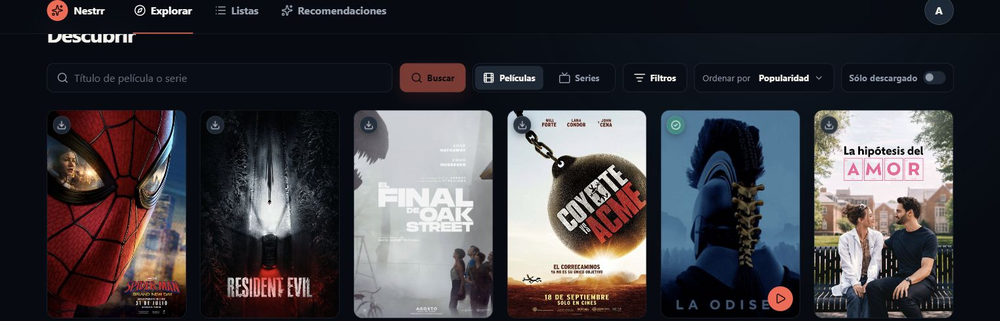
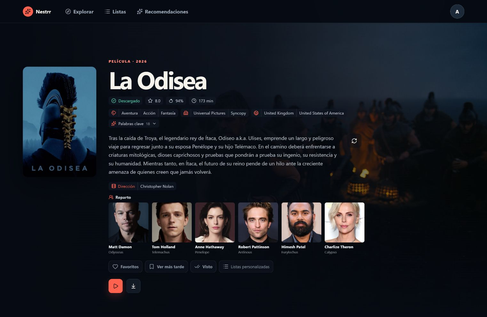

# Nestrr

Your movies, shows, and watchlists in one place. Nestrr is a self-hosted way to discover what to watch, keep track of where you left off, and play the files in your own library.



## The good stuff

- **Find your next watch.** Explore movies and shows with search, filters, and sorting. Browse cast, genres, keywords, and related titles.
- **Pick up where you left off.** Resume movies and episodes across devices, with progress visible throughout your library.
- **Make it yours.** Keep Favorites, Watch Later, and Watched lists, create your own lists, and get recommendations shaped by what you enjoy.
- **Play the way you want.** [Plarr](https://github.com/victor141516/Plarr) provides adaptive playback, quality and audio-track controls, subtitles, and Chromecast support.
- **Bring downloads home.** Optionally search with Jackett, send torrents to qBittorrent, extract archives with [Strastorr](https://github.com/victor141516/Strastorr), and let [Chiprr](https://github.com/victor141516/chiprr) organize the finished videos.



## Get started

You need Docker Compose and a [TMDB API Read Access Token](https://www.themoviedb.org/settings/api). Clone Nestrr, [Plarr](https://github.com/victor141516/Plarr), [Chiprr](https://github.com/victor141516/chiprr), and [Strastorr](https://github.com/victor141516/Strastorr) into the same parent directory. Then, from `Nestrr`:

```sh
cp .env.example .env
# Add TMDB_TOKEN and a random NESTRR_JWT_SECRET (at least 32 characters) to .env
docker compose up -d --build
```

Open **http://localhost:8080** and create the first account before exposing the instance to anyone else. That account becomes the administrator. On an NVIDIA host, including Docker Desktop with WSL, use `docker compose -f docker-compose.yml -f docker-compose.nvidia.yml up -d --build` instead, every time you recreate the stack.

For the complete setup—including Jackett, qBittorrent categories, GPU options, and access from other devices—follow the [installation guide](docs/INSTALLATION.md). For environment variables and operational details, see the [deployment reference](DEPLOYMENT.md).

## Made of independent parts

Nestrr handles the catalog, lists, progress, and discovery. Plarr handles playback. Jackett, qBittorrent, Strastorr, and Chiprr form the optional download-to-library workflow. Run the pieces that fit your setup, while keeping your media files under your control.

Screenshots show a real Nestrr instance; titles and artwork belong to their respective owners.
